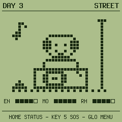
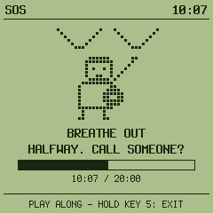
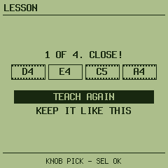

# Sober Groove for M-VAVE FM-1

**Alpha 0.1.0.** A virtual-pet recovery companion for musicians, running as custom firmware on the M-VAVE FM-1 synth. Take in a down-on-their-luck musician, teach them riffs and grooves, and grow together from rock bottom to main stage, one sober day at a time.

  

> **Support, not treatment.** Sober Groove does not replace a doctor, a therapist or a support group. Stopping heavy drinking suddenly can be dangerous: talk to a GP first. In a crisis in the UK or Ireland, Samaritans answer 24/7.

## The idea

A musician was kicked out of the band and out of the flat, and knocks on your door. You let them crash on your couch. You have your own stuff too; you are just a few steps further down the same road today.

- **Every morning, hold HOME and say "not today".** The total of sober days only ever grows.
- **Teach your buddy music.** Play a short riff on the white keys; the buddy listens and tries to play it back. Early on it makes mistakes, later it gets it right. Every lesson goes into its repertoire.
- **Two kinds of growth.** A stage needs sober days *and* lessons: **LOST → STREET → GARAGE → CLUB → MAIN STAGE**. A stage never goes back, not even after a slip.
- **SOS for cravings.** One key starts a 20-minute wave: breathe in with the bass, out in silence, play along. Halfway through, a HALT check (hungry, angry, lonely, tired?) and a small tip.
- **A slip is not the end.** The streak restarts; total days, waves, lessons and the stage stay.
- **The buddy thinks out loud** now and then, mostly curiosity, sometimes about people and support groups, rarely about a therapist, always as an interesting path, never as an order.

Three buddies to choose from: **Low** (bass), **Kit** (drums) and **Vinyl** (DJ), each with its own sound.

## Status of this alpha

This is an early test version for people who want to try it and give feedback.

- The whole app runs and is tested in the host simulator (`tests/`): first start, prologue, mornings, care, a full SOS wave, lessons, a stage up, a slip, settings and saving across restarts.
- **This alpha has not been built with the JieLi toolchain or installed on an FM-1 yet.** There is no ready-made `.fwsc` package in this release. Build it yourself ([BUILDING.md](BUILDING.md)) and install at your own risk. The platform code underneath is unchanged from firmware that installs and runs on the FM-1, and the build checks RAM, flash use and hardware access.
- The FM-1 has no clock that keeps time when off. A day counts when you hold HOME; after a restart the buddy asks whether it is a new day. While powered, the next day opens after 20 hours.

See [RELEASE-NOTES.md](RELEASE-NOTES.md) for what is in and what is planned.

## Controls

| Control | What it does |
| --- | --- |
| White keys | Play your buddy's instrument (A minor pentatonic). In a lesson, they teach. |
| Black keys 1–4 | Care: **meal · talk · move · sleep/wake**. In SOS: the HALT answers. |
| Black key 5 | **SOS** from almost anywhere. Hold it 2 s during a wave to stop early. |
| HOME | Status, then the next-stage progress. **Hold 1.5 s: "not today"** (counts the day). |
| GLO | Menu: Jam (teach), Repertoire, Help, There was a slip, Settings. Back in menus. |
| SELECT knob / SEL | Choose and confirm. |
| SAVE | Save now. Progress also saves by itself. |
| MASTER | Volume. |

## Install (after building)

You need an **M-VAVE FM-1**, a USB data cable and a computer with [Python 3](https://www.python.org/downloads/).

```sh
python3 -m venv .venv
. .venv/bin/activate
python -m pip install -r requirements-install.txt
python tools/fm1_install.py --info
python tools/fm1_install.py build/sobergroove-0.1.0-alpha.fwsc
```

Read the prompt and type `y`. Keep USB connected until the write and restart finish. A successful install reports **FM-1_506370001**. This replaces the device's current firmware; you can install the M-VAVE firmware or another community firmware again the same way. If an update is interrupted, run the same command again. `tools/fm1_rescue.py` covers a device stuck in update mode.

## Help and support groups

The device's Help screen lists where to look, without phone numbers (they change; check them on the organisations' sites):

- **Music Support** (UK): a free, confidential helpline run by people from the music industry, and recovery support groups.
- **Therapy groups** led by a professional, e.g. through the NHS or local alcohol services; ask your GP.
- **SMART Recovery**: groups based on cognitive behavioural therapy.
- **Samaritans** (UK and Ireland), 24/7.
- **AA**, as one option among others.

## Documentation

| Document | For |
| --- | --- |
| [User guide](docs/USER-GUIDE.md) | Every screen, control and feature, troubleshooting and questions |
| [Install](INSTALL.md) · [Build](BUILDING.md) | Installing and building the firmware |
| [Hardware test checklist](docs/HARDWARE-TESTING.md) | Testing the alpha on an FM-1 |
| [Design notes](docs/DESIGN.md) | The rules every feature must pass, the caretaker model, the story |
| [Architecture](docs/ARCHITECTURE.md) | Code structure, drawing, sound, game state, save format, tests |
| [Content guide](docs/CONTENT-GUIDE.md) | How the buddy talks; rules for wording and review |
| [Contributing](CONTRIBUTING.md) | How to help |
| [Release notes](RELEASE-NOTES.md) | What is in this version and what is planned |

## Source and credits

Code and original artwork: **GPL-3.0-only**. Sober Groove is built on the FM-1 platform work of [Trumpagotchi](https://github.com/adamcharleswilsonmusic-code/Trumpagotchi), FoMni, [X0X](https://github.com/charlesvestal/fm1-x0x) and [Felucca](https://github.com/hugelton/Felucca). Inherited notices are kept in [LICENSING.md](LICENSING.md) and `LICENSES/`.

"M-VAVE" and "FM-1" are trademarks of their respective owners. Sober Groove is independent firmware, not affiliated with or endorsed by M-VAVE or any organisation named here.
